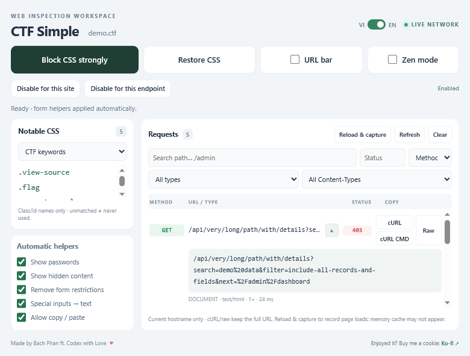
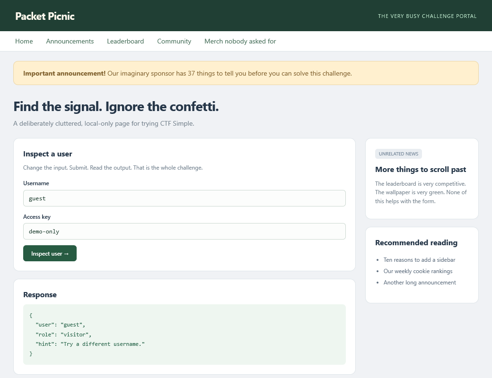
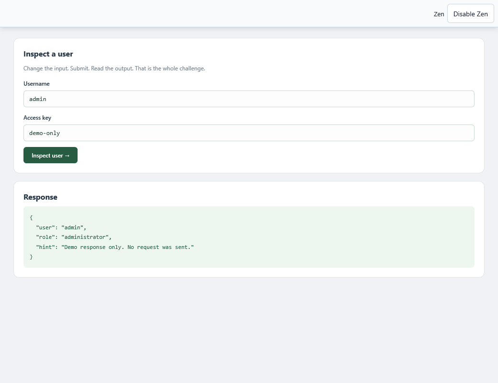
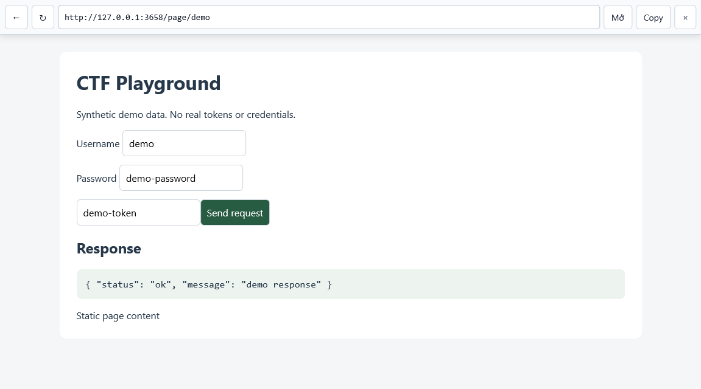

<p align="center"></p>

<h1 align="center">CTF Simple</h1>
<p align="center"><strong>Less wallpaper. More flags.</strong><br>A small Chrome / Edge extension for getting straight to the useful parts of a web challenge.</p>
<p align="center">Vanilla JavaScript · No build step · VI / EN interface · MIT · v3.2.1</p>

Remove the CSS. Spot a suspicious `.view-source`. Unmask an input. Copy a request. Keep solving.



## Get started

1. Download or clone this project.
2. Open `chrome://extensions` or `edge://extensions` and turn on **Developer mode**.
3. Click **Load unpacked** and choose **`css-blocker`**, the folder containing `manifest.json`.
4. Pin the icon, open an HTTP/HTTPS challenge, and click it.

Chrome 119+ or compatible Edge. No account, npm install, or build required. To update, reload the extension and refresh your open pages.

## One minute, fewer distractions

### 1. Turn a noisy page into input → output

Meet **Packet Picnic**, our deliberately cluttered [demo page](docs/demo.html). Announcements, navigation, sidebars, and sponsor copy all compete with one small form.

**Switch on Zen mode.** The same page keeps its form and response. The unrelated static content disappears. Switch Zen off to bring it back.

| Before Zen | After Zen |
| --- | --- |
|  |  |

Try it locally from the project root:

```sh
python -m http.server 8000
```

Open `http://localhost:8000/docs/demo.html`, enable Zen in the extension, and try the form. The demo is local and synthetic; submitting it updates a sample response without sending a request.

### 2. Peel away the styling

Click **Block CSS strongly**. Styles disappear and stay blocked after a refresh. **Restore CSS** clears that hostname's saved choice and reloads the page.

The CSS panel lists **class and ID names**, with a simple group selector: CTF keywords, not currently matched in the DOM, hidden content, or all names. No search box, no wall of stylesheet text.

```css
.view-source
.flag
.secret-panel
```

Those are examples worth a second look, not proof of a vulnerability. Unmatched today does not mean never used.

### 3. Follow the requests

Click **Reload & capture** to record a fresh page load. CSS, scripts, images, fonts, media, and embedded objects loaded as static resources are skipped. Documents, form submissions, Fetch/XHR, and other application requests remain. Rows stay compact: `GET /admin`, not a repeated hostname. Click **▾** next to a path to reveal the entire path and query on multiple lines.

Combine **method**, **resource type**, **MIME type**, **status** (`403`, `4xx`, `error`), and **path search** filters. Only requests to the current exact hostname appear.

Copy an observed request as:

| Button | Paste it into |
| --- | --- |
| **cURL** | Bash, WSL, or Git Bash |
| **cURL CMD** | Interactive Windows CMD, with delayed expansion off |
| **Raw** | A text editor or HTTP request editor; reconstructed HTTP/1.1 |

Exports keep the full URL. Repeated requests with the same tab, method, URL, and body become one row with a count.

## Small helpers, already switched on

| Feature | What changes |
| --- | --- |
| Show passwords | Password inputs become readable. |
| Show hidden content | Hidden page fields and content become visible. |
| Remove form restrictions | Removes HTML constraints such as `required`, `readonly`, `disabled`, length limits, and patterns. |
| Special inputs → text | Makes number, date, and similar inputs easier to edit. |
| Allow copy / paste | Relaxes common page-level copy and paste restrictions. |

Uncheck any helper to turn it off. Recognizable extension UI and editor internals are protected, including Code Formatter and CodeMirror/Monaco/Ace inputs.

## Keep the URL you actually typed

Enable **URL bar** for an in-page address field. **Alt+L** focuses it; Enter opens the URL; Copy preserves your typed text.

```text
http://localhost:8000/docs/demo.html?q=a b&next=%252F
```

The field keeps spaces, Unicode, and existing percent escapes without encoding or decoding them again. **Chrome still normalizes the real navigation URL.** Hover over the field to see Chrome's version. Up to 20 opened strings are remembered per tab.



## Your page, your settings

- **VI / EN:** switch the popup and in-page toolbar together; the choice is remembered.
- **Disable for this site:** pause all tools and new request recording for the exact hostname, across schemes and ports.
- **Disable for this endpoint:** pause for the exact hostname + pathname, ignoring query strings and fragments. `/admin` does not also exclude `/admin/users`.
- Use the matching **Enable** button to remove a rule. If both rules match, remove both. Preferences stay saved; changing the exclusion reloads the page to restore its DOM.

## A few honest limits

- This is a page-inspection helper. Form edits do not bypass server or JavaScript validation; Zen is a DOM heuristic and can keep or hide unexpected content.
- Capture uses Chrome's `webRequest` events: documents, Fetch/XHR, other application requests, failures, and exposed WebSocket handshakes. Static browser resource types are skipped; a Fetch/XHR call is retained even if its URL looks like an asset. It does **not** read response bodies or WebSocket messages. Memory-cache hits, browser-internal traffic, and requests before startup may be missing.
- Same-hostname filtering excludes other subdomains and CDNs. Tabless worker traffic needs a matching initiator origin; if an endpoint on that hostname is excluded, that hostname's tabless traffic is omitted because Chrome cannot reliably attribute it to an endpoint.
- **≈** means a reconstructed form body. Incomplete or oversized bodies are not exported as complete requests. WebSocket handshakes cannot be exported for HTTP replay. Raw exports are reconstructed text, not original HTTP/2/3 bytes.
- No analytics or external log service. Logs stay in local session storage: up to 1,000 groups or roughly 3 million characters across tabs. Exported headers may contain credentials; inspect copies before sharing. Persistent preferences use local storage.

<details>
<summary><strong>Permissions & development</strong></summary>

| Permission | Used for |
| --- | --- |
| `storage` | Preferences, exclusions, and session logs |
| `scripting`, `activeTab` | Apply page tools |
| `webRequest`, `<all_urls>` | Observe requests and run tools on permitted websites |
| `clipboardWrite` | Copy URLs and request exports |
| `contentSettings` | Clear this extension's old JavaScript-blocking rules during upgrades |

No debugger permission. Browser-internal pages and the Chrome Web Store are unsupported.

The extension is plain JavaScript in `css-blocker/`. Run these checks from the project root:

```sh
node css-blocker/tests/popup-v3.mjs
node css-blocker/tests/network-v3.mjs
node css-blocker/tests/background-v3.mjs
node css-blocker/tests/dom-guard.mjs
node css-blocker/tests/i18n.mjs
node css-blocker/tests/policy.mjs
node css-blocker/tests/scope.mjs
```

On Windows, `node css-blocker/tests/curl-cmd.mjs` checks CMD exports against a local server. Browser fixtures use `tests/demo-server.mjs` and Ego Browser. These use simulated Chrome APIs; load the unpacked extension in Chrome/Edge for integration checks.

The preview images use the real UI and Zen controller with synthetic demo data, rendered by Chromium to PDF and converted to PNG. The editable icon is [icon.svg](css-blocker/icons/icon.svg); regenerate its PNG sizes on Windows with `css-blocker/scripts/generate-icons.ps1`.

</details>

## Cookies keep the flags coming

Enjoyed it? Buy me a cookie: **[ko-fi.com/bachphan](https://ko-fi.com/bachphan)** 🍪

Made by **Bach Phan ft. Codex with Love**.

[MIT License](LICENSE) · Copyright © 2026 Bach Phan
